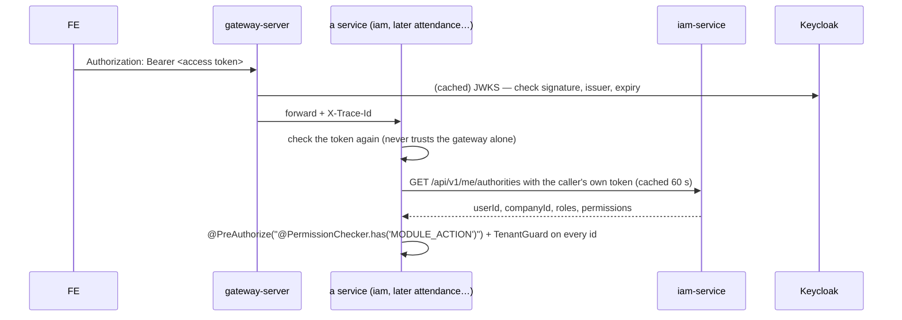

# SPECOM HRM backend

Microservices on Spring Boot 3.5 / Java 17. Keycloak proves who the caller is; the IAM service decides which
company they belong to and what they may do.

| Module | Port | What it does |
|---|---|---|
| `gateway-server` | 8080 | One entry point for the FE (`/api/v1/**`). Rejects requests without a valid Keycloak token, sets `X-Trace-Id`, routes to services. Makes no permission decision. |
| `iam-service` | 8081 | Companies (tenants), user accounts, roles, permissions. Login facade over Keycloak. Database `hrm_iam`. |
| `hrm-common` | — | Library shared by the servlet services: API envelope, error handling + i18n, trace id, resource-server setup, `PermissionChecker`, `TenantGuard`. |
| Keycloak 26 | 8180 | Realm `hrm`: passwords, sessions, brute-force lockout, token signing. Config in `deploy/keycloak/hrm-realm.json`. |

## How a request is authorized



Three checks, all required on every endpoint:

1. **Authenticated** — a Keycloak token (gateway and service).
2. **Permission** — `@PreAuthorize("@PermissionChecker.has('IAM_ROLE_VIEW')")`. Codes are `MODULE_ACTION`, seeded by
   Liquibase in the IAM database, granted through company roles. Permissions are **not** in the token: a role change,
   a locked account or a suspended company applies within the cache TTL (30 s in IAM, 60 s in other services), not at
   token expiry.
3. **Company isolation** — every row carries `company_id`. `TenantGuard.resolveCompany(...)` picks the company a
   list or create acts on (a company user can only ever get their own); `TenantGuard.assertSameCompany(...)` on every
   read/write by id answers **404** for another company's row.

`SUPER_ADMIN` is a Keycloak realm role: operates the SaaS (companies), passes every permission check, belongs to no
company and must pass `companyId` explicitly when acting on one.

Rules enforced in IAM: a caller can only grant permissions — directly in a role or through assigning a role — that
they hold themselves (`IAM_015`); `COMPANY_ADMIN` keeps every IAM permission (`IAM_012`); system roles keep their code
and cannot be deleted; nobody changes their own roles or status (`IAM_013`).

## API (through the gateway, `http://localhost:8080`)

| Method | Path | Who |
|---|---|---|
| POST | `/api/v1/auth/login` `{username, password}` → `{accessToken, refreshToken, expiresIn, refreshExpiresIn}` | public |
| POST | `/api/v1/auth/refresh-token` `{refreshToken}` (rotates: the old one stops working) | public |
| POST | `/api/v1/auth/logout` `{refreshToken}` | public |
| POST | `/api/v1/auth/initial-password` `{username, currentPassword, newPassword}` | public — first login with a temporary password (`AUTH_004`) |
| GET | `/api/v1/me` → user, companyId, roles[], permissions[] | any account |
| GET | `/api/v1/iam/permissions` | `IAM_PERMISSION_VIEW` |
| GET/POST/PUT/DELETE | `/api/v1/iam/roles[/{id}]` | `IAM_ROLE_*` |
| GET/POST | `/api/v1/iam/users`, PUT `/{id}/roles`, PUT `/{id}/status` | `IAM_USER_*` |
| GET/POST | `/api/v1/iam/companies`, PUT `/{id}/status` | super admin |

Envelope `{ result, code, data, message, traceId }`; errors carry a stable `code` (`AUTH_00x`, `IAM_0xx`,
`COMMON_00x`) and a message in `Accept-Language` (vi default, en, ko). Swagger UI: `http://localhost:8081/swagger-ui.html`
(IAM directly; the gateway does not expose it).

## Run locally

```bash
mvn -DskipTests package            # builds the jars the Dockerfiles copy
# set these in the shell or in a .env file next to docker-compose.yml (gitignored, never commit it):
#   MYSQL_ROOT_PASSWORD, IAM_DB_USERNAME, IAM_DB_PASSWORD, KC_DB_USERNAME, KC_DB_PASSWORD,
#   KC_BOOTSTRAP_ADMIN_USERNAME, KC_BOOTSTRAP_ADMIN_PASSWORD,
#   KEYCLOAK_ADMIN_CLIENT_SECRET          (secret of client hrm-iam-admin; realm import and IAM read the same value)
#   HRM_SUPERADMIN_INITIAL_PASSWORD       (temporary; ≥10 chars, upper, lower, digit)
docker compose up -d --build
```

First steps: `POST /api/v1/auth/initial-password` for `superadmin` → `POST /api/v1/iam/companies` (creates the
company, its default roles and the first `COMPANY_ADMIN`, whose temporary password is returned once) → that admin
sets a password with `initial-password` and manages users and roles.

The realm is imported only when it does not exist yet; after editing `hrm-realm.json` on a local stack, recreate it
(`docker compose down -v` — this deletes the local databases).

## Tests

`mvn package` runs the unit tests (tenant guard, permission checker, role escalation rules, login gating, temporary
password policy). The end-to-end flow above was run once against the docker stack on 2026-11-18 (26 checks: tokens,
first-login password, cross-company 404, escalation 403, lock/suspend revocation, refresh rotation, logout).

## Adding a service

1. Depend on `hrm-common`, scan `vn.specom.hrm`, configure security with
   `ResourceServerSecurity.apply(http, new RemoteAuthorityResolver(iamUrl, Duration.ofSeconds(60)), mapper, …)`.
2. Seed its permission codes in IAM (new Liquibase change file) and add them to `EDefaultRole` where a default role
   should have them.
3. Every table with company data gets `company_id`; every list uses `TenantGuard.resolveCompany`, every by-id access
   `TenantGuard.assertSameCompany`.
4. Add a route in `gateway-server/src/main/resources/application.yml`.
